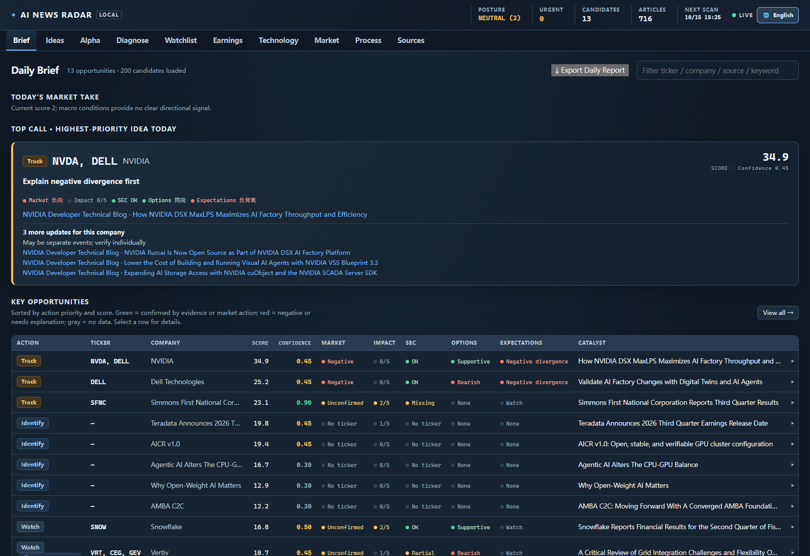

# AI News Radar

**A local-first research terminal for finding public evidence behind emerging market themes.**

[简体中文](README.zh-CN.md) · [Signal model](docs/signal_model.md) · [Product brief](docs/product_brief.md)

> **Research use only — not investment advice.** Data can be delayed or incorrect. Verify important information against its original source.

AI News Radar monitors public company, market, and technology sources, then organizes potential business signals into a reviewable research workflow. It is designed to help an analyst move from a broad theme to verifiable evidence such as customer orders, production qualification, capacity commitments, or disclosed demand.

The application runs on your computer. It does not require a hosted account, database, or paid data subscription for its core workflow.

*Current interface preview. Public-source data may change, be delayed, or be unavailable.*

## What it does

- Collects public RSS/Atom feeds and selected company investor-relations pages.
- Scores evidence with transparent rules and conservative company matching.
- Finds candidate companies beyond the configured seed watchlist.
- Builds a 72-hour research brief with linked source material and visible data gaps.
- Adds market, filings, financial, earnings, options, positioning, and technology context when a source is available.
- Provides a bilingual Chinese/English web interface, local review state, CLI reports, and Markdown/JSON exports.
- Includes forward-return reporting to help inspect how scored signals performed over time. Historical results do not predict future outcomes.

The workflow favors traceable evidence over alert volume:

1. Collect public articles and disclosures.
2. Identify business evidence and possible company matches.
3. Add available market and company context.
4. Review the original source before drawing a conclusion.
5. Compare historical scores with subsequent returns.

See [docs/signal_model.md](docs/signal_model.md) for scoring rules and false-positive controls.

## Run locally

Download the repository as a ZIP and extract it, or clone it with Git. Run the commands from the project directory. The supported distribution for now is the source repository; the application uses the checked-in [config files](config/) and writes its runtime data beside the source. If you use the ZIP, extract it first and skip the clone and cd commands below.

**Requirements:** Python 3.10 or newer. The automated test matrix covers Python 3.10 and 3.12 on Windows and Ubuntu.

### Windows PowerShell

~~~~powershell
git clone https://github.com/SeikiChan/ai-news-radar.git
cd ai-news-radar
py -3 -m venv .venv
.\.venv\Scripts\Activate.ps1
python -m pip install --upgrade pip
python -m pip install -e .
ai-news-radar web
~~~~

### macOS or Linux

~~~~bash
git clone https://github.com/SeikiChan/ai-news-radar.git
cd ai-news-radar
python3 -m venv .venv
source .venv/bin/activate
python -m pip install --upgrade pip
python -m pip install -e .
ai-news-radar web
~~~~

Open [http://127.0.0.1:8765](http://127.0.0.1:8765). The first run starts a source scan; it may take several minutes depending on network and provider response times. Stop the local server with **Ctrl+C**. On Windows, AI News Radar.cmd is also available as a double-click launcher.

### Command-line tasks

~~~~bash
ai-news-radar scan --limit 40
ai-news-radar report
ai-news-radar report --json
ai-news-radar daily --scan --export-dir reports
~~~~

## Configuration and local data

- Edit [config/sources.json](config/sources.json) to configure feeds and public market sources.
- Edit [config/watchlist.json](config/watchlist.json) to change the seed companies, aliases, and themes.
- Runtime history, review decisions, market snapshots, and downloaded caches are stored under <code>data/</code>. Daily exports are written to <code>reports/</code>.
- Runtime data and local browser-test artifacts are excluded by [.gitignore](.gitignore); they stay on the computer running the application.
- Environment variables are read from the process environment. The project does **not** automatically load a <code>.env</code> file. See [.env.example](.env.example) for supported variable names.

For SEC requests, set a descriptive User-Agent with a real contact address in the current shell before launching the app.

PowerShell:

~~~~powershell
$env:AI_NEWS_RADAR_USER_AGENT = "AI News Radar/1.0.0 (contact: you@example.com)"
~~~~

macOS or Linux:

~~~~bash
export AI_NEWS_RADAR_USER_AGENT="AI News Radar/1.0.0 (contact: you@example.com)"
~~~~

Free public endpoints can be rate-limited, delayed, or temporarily unavailable. A missing value is shown as unavailable where possible; source coverage and freshness vary. Review the linked original material and the source provider's terms before relying on any result.

## Local access and security

The web server binds to 127.0.0.1 by default and is intended for local use. Binding to a non-local interface requires AI_NEWS_RADAR_PASSWORD. Do not expose the development server directly to the public internet. If you intentionally configure remote access, use a properly secured deployment with HTTPS and review the deployment guidance in [docs/cloud_deploy.md](docs/cloud_deploy.md).

## Development

~~~~bash
python -m venv .venv
python -m pip install -e ".[dev]"
python -m pytest
ruff check src tests
node --check src/abnormal_news_radar/web_static/app.js
~~~~

Continuous integration runs tests and lint on Windows and Ubuntu with Python 3.10 and 3.12.

## Risk notice

AI News Radar is an independent software project for research and educational use. It does not provide investment, financial, tax, legal, or other professional advice. Nothing in the application is an offer or a recommendation to buy, sell, or hold any security or financial product.

The application uses automated matching, scoring, and analysis over third-party public information. Data may be delayed, incomplete, inaccurate, unavailable, or attributed to the wrong company. Scores and classifications can be wrong. Backtests and past performance do not predict future results. Verify important facts against original, current sources, conduct your own research, and consult a qualified professional when appropriate. You are responsible for decisions made using the software.

The software is provided “as is,” without warranties, to the extent permitted by applicable law. The authors and maintainers are not responsible for losses arising from its use, to the extent permitted by law. For general investor education, see the [SEC's investor resources](https://www.sec.gov/resources-investors).

## License

Licensed under the [MIT License](LICENSE).
