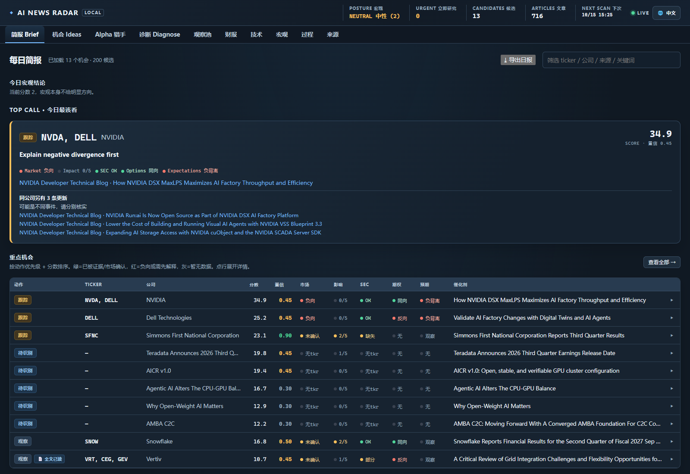

# AI News Radar

**一款在本机运行的公开市场研究终端，用于发现新兴主题背后的可验证证据。**

[English](README.md) · [信号模型](docs/signal_model.md) · [产品说明](docs/product_brief.md)

> **仅供研究，不构成投资建议。** 数据可能延迟或有误，请通过原始来源核验重要信息。

AI News Radar 持续收集公开的公司、市场和技术信息，并将潜在业务信号整理成可复核的研究流程。它帮助研究者从宽泛主题追踪到可验证的公开证据，例如客户订单、量产认证、产能承诺或已披露的需求变化。

应用运行在用户自己的电脑上。核心工作流无需托管账户、数据库或付费数据订阅。

*当前界面预览。公开来源数据可能变化、延迟或暂时不可用。*

## 功能

- 收集公开 RSS/Atom 订阅源和部分公司投资者关系页面。
- 使用透明规则给证据打分，并谨慎匹配公司名称。
- 从新闻中发现种子观察名单以外的候选公司。
- 汇总近 72 小时研究简报，附原始来源链接和数据缺口。
- 在数据源可用时补充市场、财报、财务、期权、持仓和技术信息。
- 提供中英双语界面、本地复核状态、命令行报告，以及 Markdown/JSON 导出。
- 提供前瞻收益报告，用于检查历史信号表现。历史结果不代表未来收益。

工作流优先保留可追溯证据，而非追求提醒数量：

1. 收集公开文章和披露信息。
2. 识别业务证据及可能对应的公司。
3. 补充可获取的市场和公司背景。
4. 查看原始来源后再作判断。
5. 对照后续市场表现检查历史评分。

评分规则和误报控制见[信号模型](docs/signal_model.md)。

## 本机运行

从 GitHub 下载 ZIP 并解压，或使用 Git 克隆仓库。请在项目目录中执行下列命令。目前推荐的安装方式是直接运行源码仓库：程序会读取仓库中的[配置文件](config/)，并将运行数据写在源码旁边。若使用 ZIP，请先解压，并跳过下面的 clone 和 cd 命令。

**环境要求：** Python 3.10 或更新版本。自动测试覆盖 Windows 和 Ubuntu 上的 Python 3.10、3.12。

### Windows PowerShell

~~~~powershell
git clone https://github.com/SeikiChan/ai-news-radar.git
cd ai-news-radar
py -3 -m venv .venv
.\.venv\Scripts\Activate.ps1
python -m pip install --upgrade pip
python -m pip install -e .
ai-news-radar web
~~~~

### macOS 或 Linux

~~~~bash
git clone https://github.com/SeikiChan/ai-news-radar.git
cd ai-news-radar
python3 -m venv .venv
source .venv/bin/activate
python -m pip install --upgrade pip
python -m pip install -e .
ai-news-radar web
~~~~

启动后打开 [http://127.0.0.1:8765](http://127.0.0.1:8765)。首次运行会开始扫描公开信息源，耗时取决于网络和数据提供方。按 **Ctrl+C** 停止服务。Windows 用户也可以双击运行 AI News Radar.cmd。

### 命令行

~~~~bash
ai-news-radar scan --limit 40
ai-news-radar report
ai-news-radar report --json
ai-news-radar daily --scan --export-dir reports
~~~~

## 配置与本地数据

- 编辑 [config/sources.json](config/sources.json) 配置新闻源和公开市场数据源。
- 编辑 [config/watchlist.json](config/watchlist.json) 修改种子公司、别名和主题。
- 运行历史、复核决定、市场快照和下载缓存存放在 <code>data/</code>；日报导出到 <code>reports/</code>。
- [.gitignore](.gitignore) 会排除运行数据和本地浏览器测试产物；这些数据留在运行软件的电脑上。
- 程序从当前进程环境读取环境变量，**不会自动加载 <code>.env</code> 文件**。支持的变量名见 [.env.example](.env.example)。

访问 SEC 数据前，建议在启动程序前为当前终端设置一个带真实联系邮箱的 User-Agent。

PowerShell：

~~~~powershell
$env:AI_NEWS_RADAR_USER_AGENT = "AI News Radar/1.0.0 (contact: you@example.com)"
~~~~

macOS 或 Linux：

~~~~bash
export AI_NEWS_RADAR_USER_AGENT="AI News Radar/1.0.0 (contact: you@example.com)"
~~~~

免费公开数据源可能限流、延迟或暂时不可用。数据覆盖和新鲜度因来源而异；无法获取的数据会尽可能明确标示。使用结果前请核对原始资料，并遵循数据提供方的使用条款。

## 本机访问与安全

Web 服务默认只监听 127.0.0.1，供本机访问。绑定到非本机地址时必须设置 AI_NEWS_RADAR_PASSWORD。不要把开发服务器直接暴露到公网。如需远程访问，请使用妥善配置 HTTPS 的部署方式，并先阅读[部署说明](docs/cloud_deploy.md)。

## 开发

~~~~bash
python -m venv .venv
python -m pip install -e ".[dev]"
python -m pytest
ruff check src tests
node --check src/abnormal_news_radar/web_static/app.js
~~~~

持续集成在 Windows 和 Ubuntu 上使用 Python 3.10、3.12 执行测试和代码检查。

## 风险与免责说明

AI News Radar 是独立的软件项目，仅供研究和教育用途，不提供投资、财务、税务、法律或其他专业意见。应用生成的内容不构成买入、卖出或持有任何证券或金融产品的要约或建议。

本软件使用自动匹配、规则评分和第三方公开信息。数据可能延迟、不完整、不准确、不可用，或错误关联到公司；评分和分类也可能出错。回测和历史表现不代表未来结果。请通过当前的原始来源核实重要信息，独立开展研究，并在适当时咨询合格专业人士。使用者自行承担基于本软件作出决定的责任。

在适用法律允许的范围内，本软件按“现状”提供，不作任何保证；作者和维护者不对使用本软件造成的损失承担责任。更多投资者教育信息可见 [SEC 投资者资源](https://www.sec.gov/resources-investors)。

## 许可证

本项目采用 [MIT License](LICENSE)。
